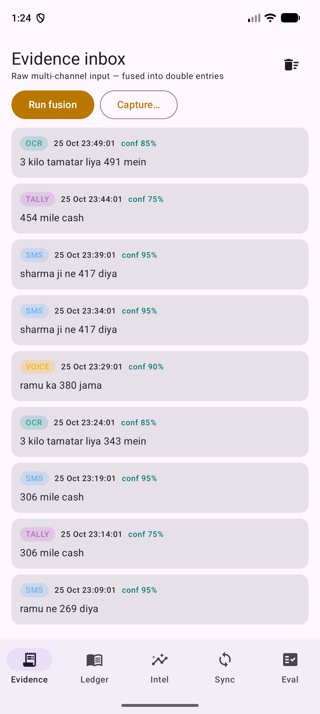
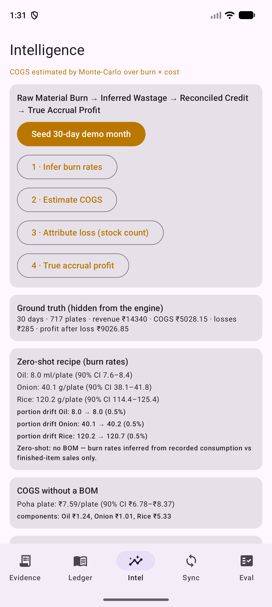
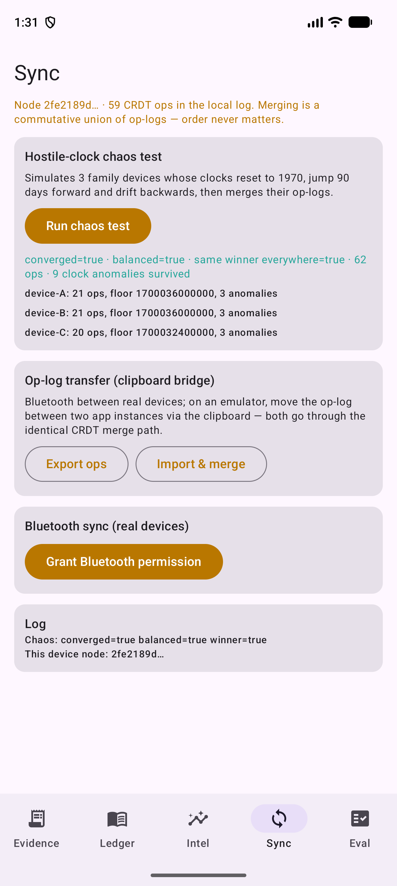
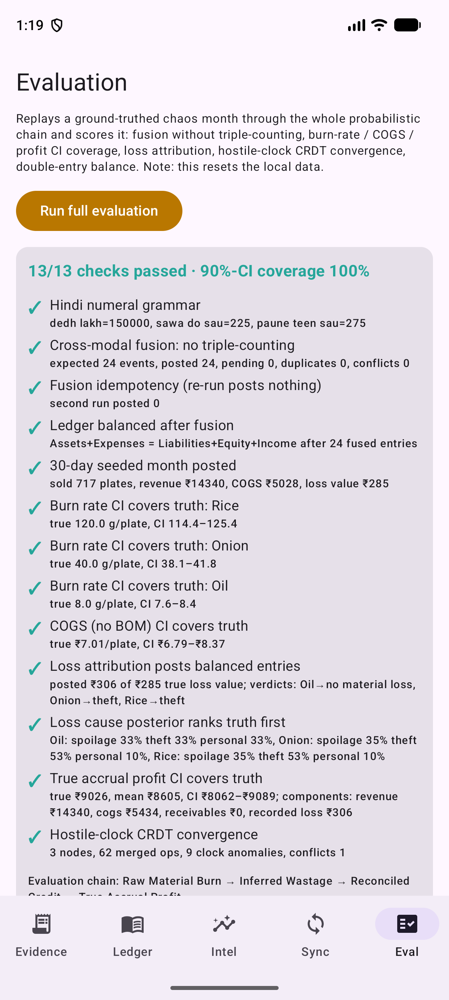

# BillO — the invisible worker's ledger

**A fully offline, on-device probabilistic ledger engine for street vendors.** BillO passively accepts chaotic, contradictory evidence — a crumpled, oil-stained wholesale slip plus ambient Hinglish speech under 85 dB traffic noise ("Bhai 3 kilo tamatar liya 180 mein… Sharma ji ka 40 jama kar, aur 7 plate poha de") plus delayed SMS chimes and handwritten tallies — and reconstructs a **double-entry ledger** from that chaos, outputting **ranges and confidence intervals**, never blind point guesses.

## Offline-first, enforced by the OS

The Android manifest declares **no `INTERNET` permission**. No component can reach a network — offline-first is a platform guarantee, not a policy. Everything below runs on-device:

| Layer | Engine |
|---|---|
| Hindi/Hinglish speech | Vosk (Kaldi) acoustic model, 16 kHz PCM, zero network |
| Noise gate | live RMS→dBFS metering; above −22 dBFS voice evidence is down-weighted (the 85 dB case) |
| Slip / tally OCR | ML Kit bundled Latin + Devanagari recognizers + grayscale/contrast preprocessing for oil-stained paper |
| Delayed SMS | passive `SMS_RECEIVED` receiver + inbox backfill, deduped |
| Camera tallies | CameraX capture → OCR pipeline |
| Numerals & units | Hindi numeral grammar (dedh/dhai/sawa/paune/saadhe, hazaar/lakh/crore) + commerce-unit normalization (kilo/plate/darjan…) |
| Inference | discrete distributions, Beta posteriors, Monte-Carlo — all local |

## The probabilistic evaluation chain

**Raw Material Burn → Inferred Wastage → Reconciled Credit → True Accrual Profit** — every stage a distribution, verified against injected ground truth by the built-in evaluation harness.

| | |
|---|---|
|  |  |
|  |  |

- **Evidence inbox** — raw multi-channel input with per-item calibrated confidence and on-device amount/unit hints, before fusion.
- **Intelligence** — zero-shot recipe inference (Rice 120 g/plate, CI 114–125, deduced from burn rates with **no Bill of Materials**), portion-size drift, COGS per plate (₹7.59, CI ₹6.78–₹8.37), loss attribution (spoilage/theft/personal as covariate-driven posteriors: monsoon, weekends, festival proximity), and true accrual profit vs cash-on-hand.
- **Sync** — CRDT op-log merge over Bluetooth RFCOMM (clipboard bridge on the emulator, same merge path), hybrid logical clocks that survive 1970 resets and forward jumps, deterministic resolution of contradictory credit claims.
- **Evaluation** — 13/13 checks passed, 100% 90%-CI coverage on-device.

## Architecture

```
Evidence (voice · OCR · SMS · tallies)          ← Phase 1 perception, all on-device
   └─> BayesianResolver  (posterior over kind/amount/person, calibrated confidence)
   └─> Lexicon Drop      (mid-event learning of unknown words/units)
   └─> FusionEngine      (cluster → ONE balanced double entry; idempotent by
                          deterministic uuid; contradictions resolved by
                          posterior weight; partial evidence stays RAW)
         └─> LedgerRepository  (Room/SQLite; refuses unbalanced entries;
               every mutation emits an immutable CRDT op with an HLC)
               ├─> RecipeInference  (daily burn-rate allocation + bootstrap CI)
               ├─> CogsEstimator    (Monte-Carlo burn × cost)
               ├─> LossAttribution  (covariate priors × magnitude likelihood)
               └─> AccrualReporter  (accrual profit vs cash-on-hand)
               └─> CrdtMerge        (union merge by opId; hostile-clock HLC;
                     BluetoothSyncService / clipboard bridge)
                     └─> EvaluationHarness (ground-truth chaos month → 13 checks)
```

**The double-entry invariant:** `Assets + Expenses = Liabilities + Equity + Income`, held from the first entry and re-verified after every stage — including after CRDT merges with devices whose clocks reset to 1970.

## One-time setup (performed once on a connected machine)

Download `vosk-model-small-hi-0.22` from [alphacephei.com/vosk/models](https://alphacephei.com/vosk/models) and extract it to `Android/data/com.billo.ledger/files/model-hi/` on the device. After that, speech recognition is permanently offline. Everything else works out of the box.

## Build

```bash
./gradlew :app:assembleDebug     # or open in Android Studio
./gradlew :app:installDebug      # with an emulator/device attached
```

Kotlin 2.0 · Jetpack Compose · Room · Vosk · ML Kit · CameraX · min SDK 26. No internet permission, no cloud, no accounts.

## Roadmap status

- [x] **Phase 0** — teardown of the previous cloud codebase; on-device shell; double-entry core with balance invariant
- [x] **Phase 1** — offline perception: Vosk STT + noise gate, on-device OCR, SMS ingestion, camera tallies, Hindi numerals + units
- [x] **Phase 2** — probabilistic core: `Dist` on every fact, Bayesian resolution, calibrated confidence, mid-event Lexicon Drop
- [x] **Phase 3** — cross-modal fusion without triple-counting; partial/contradictory evidence handling
- [x] **Phase 4** — zero-shot recipe inference, loss attribution, COGS, true accrual profit
- [x] **Phase 5** — CRDT sync over Bluetooth, hostile clocks, contradictory credit claims
- [x] **Phase 6** — probabilistic UI, evaluation harness (13/13, 100% CI coverage), demo data, docs
